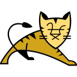
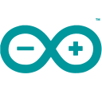
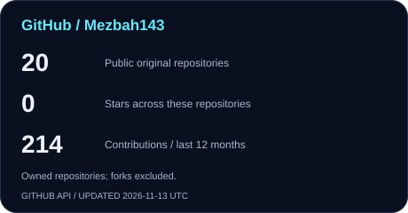
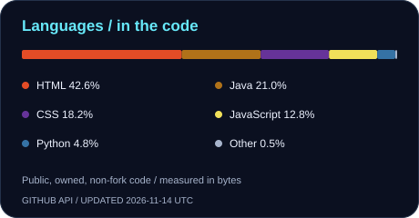
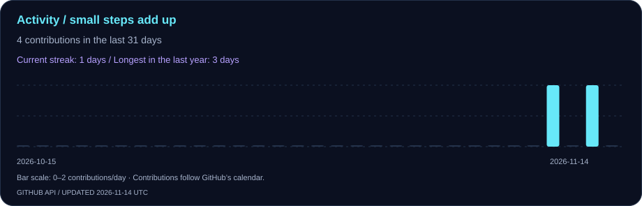

<picture>
  <source media="(max-width: 600px)" srcset="assets/header-mobile.svg">
  
</picture>

  
  
  

## A little about me

I’m **Mezbah Uddin**, an Information Technology student at **Ulsan College, South Korea**, working toward a career in software and full-stack development. I enjoy turning everyday problems into useful applications, from the interface people see to the backend logic and data behind it.

- **Education:** Bachelor’s degree in Information Technology · expected June 2027
- **Building with:** Java, web technologies, backend systems, and databases
- **Exploring:** Kotlin and mobile apps, AI, and better ways to solve problems
- **Open to:** software internships, learning opportunities, and thoughtful collaboration

## Selected work

<table width="100%">
<tr><td>

### 01 · StudentBridge

**Helping international students navigate part-time job opportunities in South Korea.**

A team capstone combining a job-search interface with Java Servlet authentication and MySQL integration. The current prototype uses seeded job listings; application submission is a future backend milestone.

[Explore the repository ↗](https://github.com/CapstoneDesign-Spring2026-UlsanCollege/StudentBridge)

</td></tr>
<tr><td>

### 02 · SoccerSense

**A single place to explore the world of football.**

A football information prototype with interfaces for fixtures, leagues, teams, news, and analysis. Live-data integrations are still in progress.

[Explore the source in SDLC-PROJECT ↗](https://github.com/Mezbah143/SDLC-PROJECT)

</td></tr>
<tr><td>

### 03 · JavaFX ATM System

**Exploring everyday banking workflows through a desktop application.**

A Java and JavaFX learning project covering authentication, deposits, withdrawals, balance management, and PIN updates.

Repository: [ADD VERIFIED JAVAFX ATM REPOSITORY]

</td></tr>
<tr><td>

### 04 · Arduino Password Door Lock

**Connecting software logic to a physical access-control prototype.**

A keypad-based door-lock project combining password input, LCD feedback, and servo control on Arduino.

Repository: [ADD VERIFIED ARDUINO REPOSITORY]

</td></tr>
</table>

## My development toolkit

**Languages**

  &nbsp;
  &nbsp;
  &nbsp;
  &nbsp;
  

**Frontend** · HTML5, CSS3, JavaScript

  &nbsp;
  &nbsp;
  

**Backend & databases** · Java Servlets, Apache Tomcat, MySQL

  &nbsp;
  &nbsp;
  

<b>Tools I work with</b>

Git · GitHub · IntelliJ IDEA · VS Code · Android Studio · Arduino

  &nbsp;
  &nbsp;
  &nbsp;
  &nbsp;
  &nbsp;
  

## Building, one contribution at a time

  
  

Updated daily from GitHub’s API · Language proportions describe repository code, not proficiency.

### A little motion, a lot of small steps

<picture>
  <source media="(prefers-color-scheme: dark)" srcset="https://raw.githubusercontent.com/Mezbah143/Mezbah143/output/github-snake-dark.svg">
  
</picture>

## Let’s build something useful

Interested in a project, an internship, or exchanging ideas? I’d love to connect.

**[Portfolio ↗](https://mezbah143.github.io/MyProtfolio/)** &nbsp;·&nbsp; **[Email ↗](mailto:mejbahuddin664094@gmail.com)** &nbsp;·&nbsp; **[GitHub ↗](https://github.com/Mezbah143)**

LinkedIn: [ADD VERIFIED LINKEDIN PROFILE]

